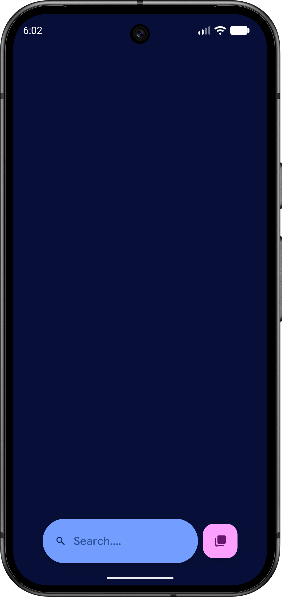
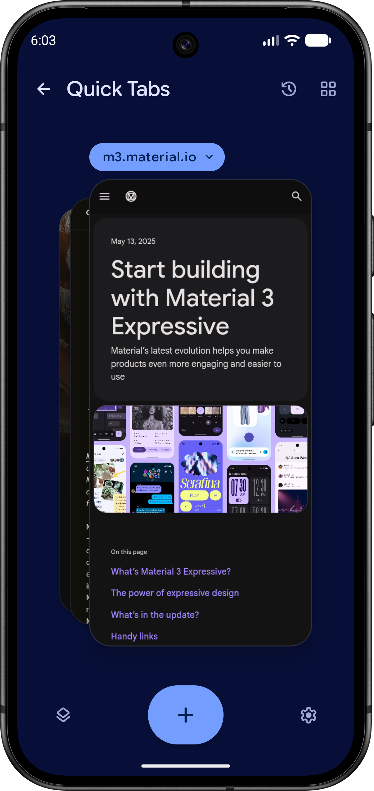
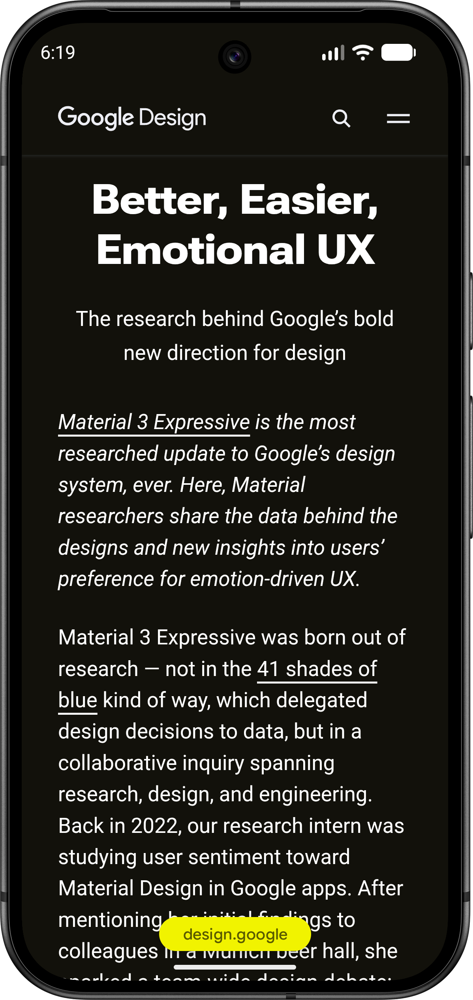

<div align="center">


<br><br>

# Verve Browser

**A tactile, thumb-first Android browser built with Material 3 Expressive and a native Rust ad-blocking core.**

<br>

<p align="center">
  <a href="https://github.com/afsanifti/Verve-Browser/releases/latest/download/Verve-Browser.apk"><picture><source media="(prefers-color-scheme: dark)" srcset="docs/readme/dark/btn-download.svg"></picture></a>
  <a href="https://github.com/afsanifti/Verve-Browser/releases"><picture><source media="(prefers-color-scheme: dark)" srcset="docs/readme/dark/btn-releases.svg"></picture></a>
  <a href="https://github.com/afsanifti/Verve-Browser"><picture><source media="(prefers-color-scheme: dark)" srcset="docs/readme/dark/btn-source.svg"></picture></a>
  <a href="#capabilities"><picture><source media="(prefers-color-scheme: dark)" srcset="docs/readme/dark/btn-features.svg"></picture></a>
  <a href="https://github.com/afsanifti/Verve-Browser/issues/new"><picture><source media="(prefers-color-scheme: dark)" srcset="docs/readme/dark/btn-issue.svg"></picture></a>
</p>

<p align="center">
  <picture><source media="(prefers-color-scheme: dark)" srcset="docs/readme/dark/badge-m3e.svg"></picture>
  <picture><source media="(prefers-color-scheme: dark)" srcset="docs/readme/dark/badge-kotlin.svg"></picture>
  <picture><source media="(prefers-color-scheme: dark)" srcset="docs/readme/dark/badge-rust.svg"></picture>
  <picture><source media="(prefers-color-scheme: dark)" srcset="docs/readme/dark/badge-android.svg"></picture>
  <picture><source media="(prefers-color-scheme: dark)" srcset="docs/readme/dark/badge-ota.svg"></picture>
  <picture><source media="(prefers-color-scheme: dark)" srcset="docs/readme/dark/badge-oss.svg"></picture>
</p>

<br>

[Overview](#overview) · [Interface](#interface) · [Capabilities](#capabilities) · [Stack](#stack) · [Build](#build)

</div>

<br>

<p align="center">
  <picture>
    <source media="(prefers-color-scheme: dark)" srcset="docs/readme/divider-dark.svg">
    
  </picture>
</p>

##  Overview

Most mobile browsers stretch primary actions across the top edge of tall displays. **Verve** flips that layout—anchoring navigation, tab switching, and private browsing inside a single bottom pill engineered for natural one-handed reach.

* **Physics over static transitions:** Gestures drive spring animations with tactile haptic feedback, letting you flick between tabs or collapse the toolbar mid-scroll without breaking focus.
* **Native speed where it counts:** Network filtering runs inside a compiled **Rust** JNI library (`native_adblock`) rather than heavy JavaScript injection, keeping page loads snappy and battery usage low.
* **Self-updating out of the box:** Built-in release checks fetch manifests directly from GitHub's release CDN, verify APK SHA-256 signatures locally, and present formatted changelogs right inside **About Verve**.

> **Current Release:** `v1.0.0-alpha.11` · Android 10+ · [View All Releases](https://github.com/afsanifti/Verve-Browser/releases)

<p align="center">
  <picture>
    <source media="(prefers-color-scheme: dark)" srcset="docs/readme/divider-dark.svg">
    
  </picture>
</p>

##  Interface

<div align="center">
  <table>
    <tr>
      <td align="center" width="25%">
        <br>
        <sub><b>Bottom Search Pill</b></sub>
      </td>
      <td align="center" width="25%">
        <br>
        <sub><b>Spring Tab Swiping</b></sub>
      </td>
      <td align="center" width="25%">
        <br>
        <sub><b>Quick Tabs Grid</b></sub>
      </td>
      <td align="center" width="25%">
        <br>
        <sub><b>In-App Updater</b></sub>
      </td>
    </tr>
  </table>
</div>

<p align="center">
  <picture>
    <source media="(prefers-color-scheme: dark)" srcset="docs/readme/divider-dark.svg">
    
  </picture>
</p>

##  Capabilities

###  Gesture-Driven Navigation
- **Scroll-Aware Search Pill:** Automatically tucks away while reading long articles and expands smoothly when scrolling back up or tapping the bar.
- **Horizontal Pill Tab Swiping:** Drag left or right across the bottom bar to switch adjacent tabs with spring-compressed side buttons and edge rubber-banding.
- **Instant Incognito Toggle:** Switch into an isolated private session directly from the search bar with adaptive dark tonal styling.

###  Performance & Filtering
- **Native Rust Ad-Blocker:** Powered by `native_adblock` compiled via `cargo-ndk` for `arm64-v8a` and `x86_64`, stripping ads and trackers at the native layer.
- **Pooled WebViews & Clean Previews:** `TabWebViewPool` keeps tab transitions responsive while `TabThumbnailCache` captures clean, toolbar-free page snapshots across memory and disk.

###  Personalization & Updates
- **Adaptive Dynamic Color:** Built with Jetpack Compose and `MaterialKolor` to harmonize surfaces, containers, and system bars with your wallpaper in both light and dark modes.
- **Verified In-App Updater:** Downloads new releases directly over GitHub's CDN, validates SHA-256 checksums before installation, and keeps full Markdown release notes accessible in **About Verve**.

<p align="center">
  <picture>
    <source media="(prefers-color-scheme: dark)" srcset="docs/readme/divider-dark.svg">
    
  </picture>
</p>

##  Stack

| Component | Technology |
| :--- | :--- |
| **App & UI** | Kotlin · Jetpack Compose · Material 3 Expressive · `MaterialKolor` |
| **Ad-Blocking Core** | Rust · JNI · `cargo-ndk` (`arm64-v8a`, `x86_64`) |
| **Build System** | Gradle Kotlin DSL · JDK 21 · Android SDK (API 29+) |
| **Release Pipeline** | GitHub Actions · `apksigner` · Automated SHA-256 `update.json` |

<p align="center">
  <picture>
    <source media="(prefers-color-scheme: dark)" srcset="docs/readme/divider-dark.svg">
    
  </picture>
</p>

##  Build

Ensure you have **JDK 21**, the **Android SDK**, and a **Rust toolchain** with [`cargo-ndk`](https://github.com/bbqsrc/cargo-ndk) installed:

```bash
# 1. Clone the repository
git clone [https://github.com/afsanifti/Verve-Browser.git](https://github.com/afsanifti/Verve-Browser.git)
cd Verve-Browser

# 2. Add Rust Android targets and install cargo-ndk
rustup target add aarch64-linux-android x86_64-linux-android
cargo install cargo-ndk

# 3. Compile native ad-blocker libraries
cd native_adblock
cargo ndk -t arm64-v8a -t x86_64 -o ../app/src/main/jniLibs build --release
cd ..

# 4. Build the Android APK
./gradlew assembleDebug
```

<p align="center">
  <picture>
    <source media="(prefers-color-scheme: dark)" srcset="docs/readme/divider-dark.svg">
    
  </picture>
</p>

##  License

Verve Browser is released under the terms in [`LICENSE`](LICENSE).