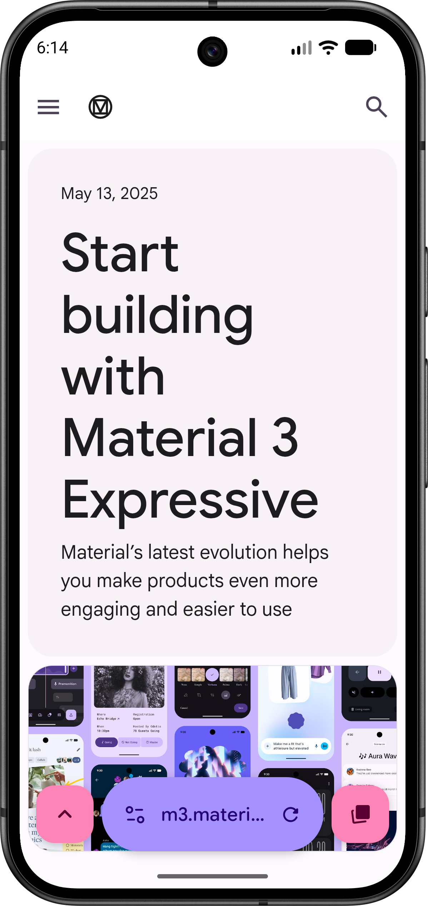
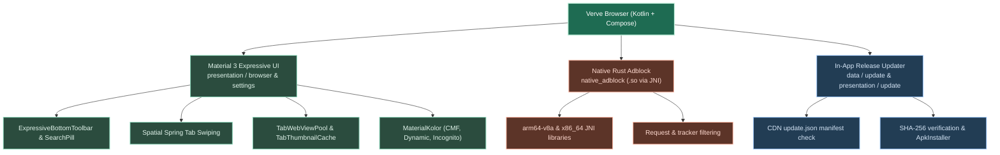

<div align="center">


<br><br>

# Verve Browser

**A fast, gesture-first Android browser with a Material 3 Expressive interface and a native Rust ad-blocking engine.**

<br>

<p align="center">
  <a href="[https://github.com/afsanifti/Verve-Browser/releases/latest/download/Verve-Browser.apk](https://github.com/afsanifti/Verve-Browser/releases/latest/download/Verve-Browser.apk)"><picture><source media="(prefers-color-scheme: dark)" srcset="docs/readme/dark/btn-download.svg"></picture></a>
  <a href="[https://github.com/afsanifti/Verve-Browser/releases](https://github.com/afsanifti/Verve-Browser/releases)"><picture><source media="(prefers-color-scheme: dark)" srcset="docs/readme/dark/btn-releases.svg"></picture></a>
  <a href="[https://github.com/afsanifti/Verve-Browser](https://github.com/afsanifti/Verve-Browser)"><picture><source media="(prefers-color-scheme: dark)" srcset="docs/readme/dark/btn-source.svg"></picture></a>
  <a href="#features"><picture><source media="(prefers-color-scheme: dark)" srcset="docs/readme/dark/btn-features.svg"></picture></a>
  <a href="[https://github.com/afsanifti/Verve-Browser/issues/new](https://github.com/afsanifti/Verve-Browser/issues/new)"><picture><source media="(prefers-color-scheme: dark)" srcset="docs/readme/dark/btn-issue.svg"></picture></a>
</p>

<p align="center">
  <picture><source media="(prefers-color-scheme: dark)" srcset="docs/readme/dark/badge-m3e.svg"></picture>
  <picture><source media="(prefers-color-scheme: dark)" srcset="docs/readme/dark/badge-kotlin.svg"></picture>
  <picture><source media="(prefers-color-scheme: dark)" srcset="docs/readme/dark/badge-rust.svg"></picture>
  <picture><source media="(prefers-color-scheme: dark)" srcset="docs/readme/dark/badge-android.svg"></picture>
  <picture><source media="(prefers-color-scheme: dark)" srcset="docs/readme/dark/badge-cmf.svg"></picture>
  <picture><source media="(prefers-color-scheme: dark)" srcset="docs/readme/dark/badge-ota.svg"></picture>
  <picture><source media="(prefers-color-scheme: dark)" srcset="docs/readme/dark/badge-oss.svg"></picture>
</p>

<br>

[Quick Facts](#quick-facts) · [Screenshots](#screenshots) · [Features](#features) · [Tech Stack](#tech-stack) · [Architecture](#architecture) · [Building](#building)

</div>

<br>

Verve is a modern Android browser designed around one-handed ergonomics and expressive motion. Every core control sits within thumb reach inside a collapsible bottom search pill with spatial spring tab swiping, backed by a multi-threaded **Rust** JNI ad-blocker (`native_adblock`) and an interface built 100% in **Kotlin** and **Jetpack Compose**.

**Latest release: v1.0.0-alpha.11** · Material 3 Expressive · Native Rust Adblock · [Releases](https://github.com/afsanifti/Verve-Browser/releases)

<br>

<p align="center">
  <picture>
    <source media="(prefers-color-scheme: dark)" srcset="docs/readme/divider-dark.svg">
    
  </picture>
</p>

##  Quick Facts

<table width="100%">
<thead><tr><th align="left" width="28%">Attribute</th><th align="left">Details</th></tr></thead>
<tbody>
<tr><td><b>App</b></td><td>Verve Browser (<code>com.verve.browser</code>), latest release <code>v1.0.0-alpha.11</code></td></tr>
<tr><td><b>Platform</b></td><td>Android 10 and above, compiled with JDK 21 and Gradle Kotlin DSL</td></tr>
<tr><td><b>UI & Design</b></td><td>Jetpack Compose, Material 3 Expressive, and <code>MaterialKolor</code> (CMF, Dynamic Color & Incognito palettes)</td></tr>
<tr><td><b>Ad & tracker blocking</b></td><td>Native Rust <code>native_adblock</code> engine compiled via <code>cargo-ndk</code> for <code>arm64-v8a</code> and <code>x86_64</code></td></tr>
<tr><td><b>Tab management</b></td><td>Multi-instance <code>TabWebViewPool</code>, hybrid RAM/Disk <code>TabThumbnailCache</code>, and bottom-pill gesture switching</td></tr>
<tr><td><b>In-app updates</b></td><td>CDN-backed GitHub release fetcher with SHA-256 verification and persistent Markdown release notes</td></tr>
<tr><td><b>License</b></td><td>See <a href="LICENSE"><code>LICENSE</code></a></td></tr>
</tbody>
</table>

<p align="center">
  <picture>
    <source media="(prefers-color-scheme: dark)" srcset="docs/readme/divider-dark.svg">
    
  </picture>
</p>

##  Screenshots

<div align="center">
  
  
  
  
</div>

<p align="center">
  <picture>
    <source media="(prefers-color-scheme: dark)" srcset="docs/readme/divider-dark.svg">
    
  </picture>
</p>

##  Features

<table width="100%">
<tr>
<td width="50%" valign="top">
<h4> Expressive bottom bar</h4>
Anchored at the bottom for effortless one-handed use. Collapses smoothly as you scroll through articles and expands on tap or upward swipe.
</td>
<td width="50%" valign="top">
<h4> Spatial spring tab swiping</h4>
Swipe left or right directly on the search pill to glide between open tabs while neighboring buttons compress organically with haptic feedback.
</td>
</tr>
<tr>
<td width="50%" valign="top">
<h4> Native Rust ad-blocker</h4>
A compiled Rust JNI engine (<code>native_adblock</code>) filters ads and trackers across <code>arm64-v8a</code> and <code>x86_64</code> architectures with minimal memory and battery overhead.
</td>
<td width="50%" valign="top">
<h4> CMF & adaptive themes</h4>
Built on <code>MaterialKolor</code> with Material You wallpaper colors, a curated <b>CMF</b> palette, and an animated <b>Incognito</b> mode toggle.
</td>
</tr>
<tr>
<td width="50%" valign="top">
<h4> Quick Tabs & live previews</h4>
Backed by <code>TabWebViewPool</code> and a hybrid RAM/Disk <code>TabThumbnailCache</code> that captures hardware-accelerated, toolbar-free page snapshots.
</td>
<td width="50%" valign="top">
<h4> Seamless in-app updater</h4>
Checks GitHub Releases over direct CDN links without API rate limits, verifies APK SHA-256 hashes, and displays formatted release notes in <b>About Verve</b>.
</td>
</tr>
</table>

<p align="center">
  <picture>
    <source media="(prefers-color-scheme: dark)" srcset="docs/readme/divider-dark.svg">
    
  </picture>
</p>

##  Tech Stack

<table width="100%">
<thead><tr><th align="left" width="25%">Layer</th><th align="left" width="35%">Library / Tool</th><th align="left">Role</th></tr></thead>
<tbody>
<tr><td><b>Language</b></td><td>Kotlin & Rust</td><td>100% Kotlin for the Android app; Rust for the native JNI ad-blocking core.</td></tr>
<tr><td><b>UI</b></td><td>Jetpack Compose · Material 3 · <code>MaterialKolor</code></td><td>Expressive shapes, spatial spring physics, dynamic color, and CMF palettes.</td></tr>
<tr><td><b>Native Bridge</b></td><td><code>cargo-ndk</code> · JNI</td><td>Cross-compiles <code>native_adblock</code> into <code>arm64-v8a</code> and <code>x86_64</code> <code>.so</code> libraries.</td></tr>
<tr><td><b>Tab & Media</b></td><td><code>TabWebViewPool</code> · <code>TabThumbnailCache</code></td><td>Pooled WebView lifecycle and hybrid RAM/Disk snapshot caching.</td></tr>
<tr><td><b>Updater & CI</b></td><td>GitHub Actions · <code>apksigner</code> · SHA-256</td><td>Automated signed APK releases, manifest generation, and verified in-app installs.</td></tr>
</tbody>
</table>

<p align="center">
  <picture>
    <source media="(prefers-color-scheme: dark)" srcset="docs/readme/divider-dark.svg">
    
  </picture>
</p>

##  Architecture



<details>
<summary><b>Package map</b></summary>
<br>

| Path | Responsibility |
| :--- | :--- |
| `app/src/main/java/com/verve/browser/presentation/browser/` | `ExpressiveBottomToolbar`, `SearchPill`, gesture tab switching, `TabThumbnailCache`, and `TabWebViewPool`. |
| `app/src/main/java/com/verve/browser/presentation/settings/` | Theme settings (`CMF` & dynamic color) and `AboutVerveScreen` with Markdown release notes. |
| `app/src/main/java/com/verve/browser/presentation/update/` | `AppUpdateController` and `AppUpdateSheet` modal UI. |
| `app/src/main/java/com/verve/browser/data/update/` | `GitHubReleaseUpdateRepository`, `ApkInstaller`, and update notifications. |
| `native_adblock/` | Rust JNI ad-blocking engine compiled into `app/src/main/jniLibs/`. |
| `.github/workflows/build-apks.yml` | CI/CD pipeline for Rust compilation, APK signing, `update.json`, and GitHub Releases. |

</details>

<p align="center">
  <picture>
    <source media="(prefers-color-scheme: dark)" srcset="docs/readme/divider-dark.svg">
    
  </picture>
</p>

##  Building

You need **JDK 21**, the **Android SDK**, and the **Rust toolchain** with [`cargo-ndk`](https://github.com/bbqsrc/cargo-ndk).

```bash
# 1. Clone the repository
git clone https://github.com/afsanifti/Verve-Browser.git
cd Verve-Browser

# 2. Install Rust Android targets & cargo-ndk
rustup target add aarch64-linux-android x86_64-linux-android
cargo install cargo-ndk

# 3. Compile native Rust adblock libraries
cd native_adblock
cargo ndk -t arm64-v8a -t x86_64 -o ../app/src/main/jniLibs build --release
cd ..

# 4. Build the Android APK
./gradlew assembleDebug      # debug APK
./gradlew assembleRelease    # signed release APK
```

<p align="center">
  <picture>
    <source media="(prefers-color-scheme: dark)" srcset="docs/readme/divider-dark.svg">
    
  </picture>
</p>

##  License

Verve Browser is distributed under the terms of [`LICENSE`](LICENSE).